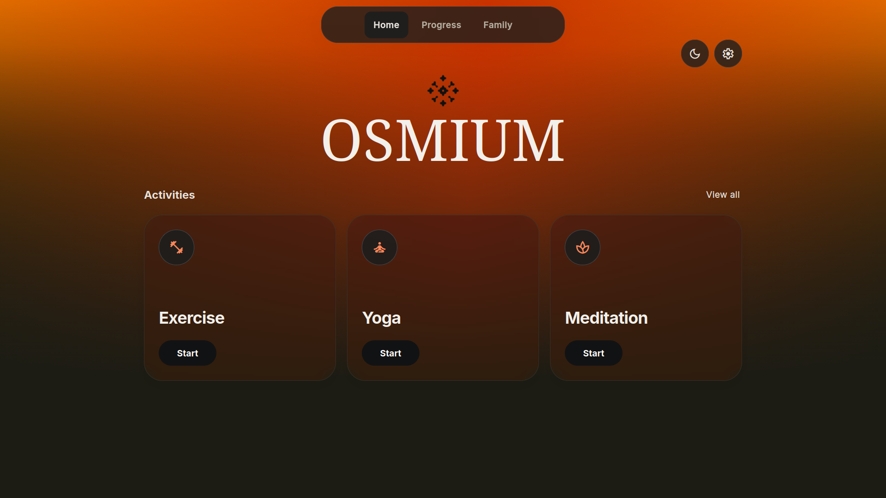
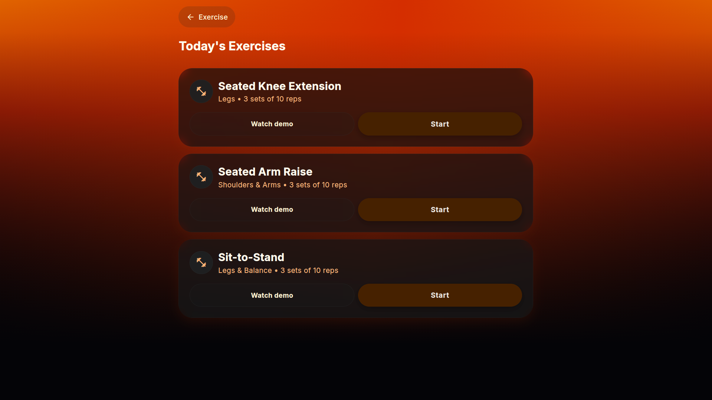
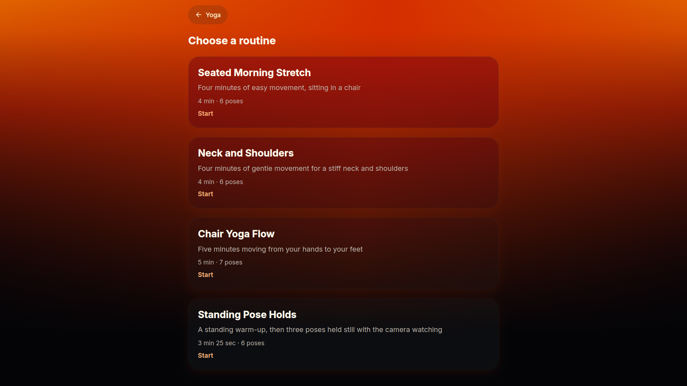
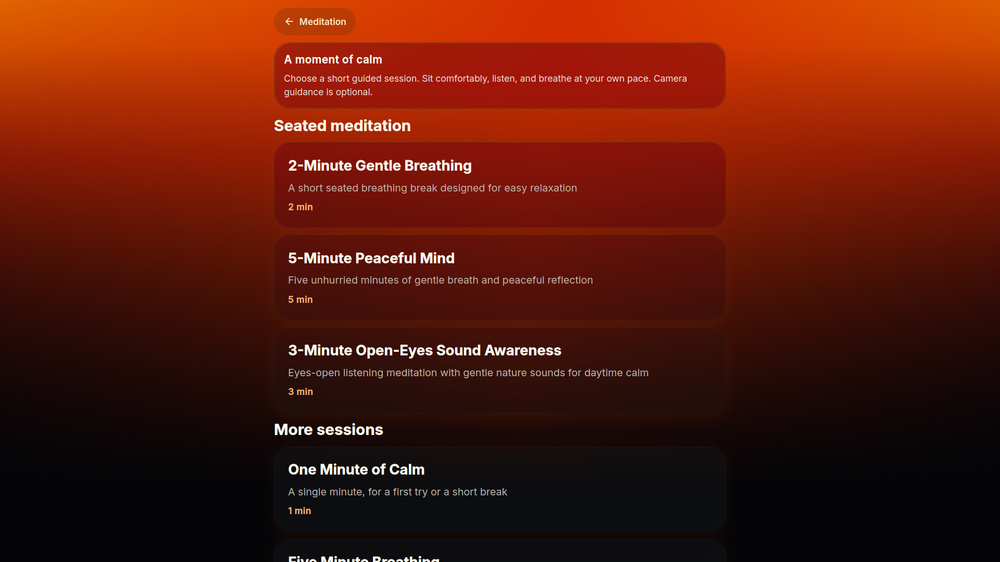

# OSMIUM (NOVNN)

**OSMIUM** is an accessible daily wellness and movement app designed primarily for **elderly users**. Built with React Native and Expo, it features a warm, high-contrast interface with clear visual feedback, progress tracking, and family connectivity.



## Core Features

### Exercise (Live Camera Detection)
Real-time camera-based pose detection and posture guidance for safe, seated and standing movements (*Seated Knee Extension*, *Seated Arm Raise*, *Sit-to-Stand*).



### Yoga
Gentle, structured routines tailored for mobility, balance, and flexibility (*Seated Morning Stretch*, *Neck and Shoulders*, *Chair Yoga Flow*, *Standing Pose Holds*).



### Meditation
Short, elder-friendly guided breathing and sound-awareness sessions (*2-Minute Gentle Breathing*, *5-Minute Peaceful Mind*, *3-Minute Open-Eyes Sound Awareness*, *One Minute of Calm*) with calming nature audio and natural female voice guidance.



## Getting Started

### Run on Web
```bash
npx expo start --web
```

### Run on Mobile (Expo Go)
```bash
npx expo start --go --tunnel
```

### Run on Android (Local Build)
Requires Java 17 and Android SDK configured with a connected device:
```bash
npx expo run:android
```
